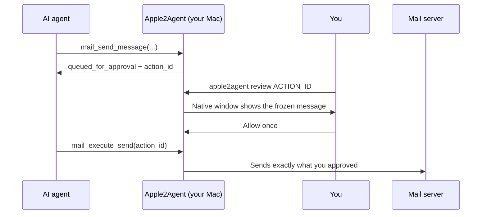

<div align="center">

# Apple2Agent

**Let AI agents work with your Apple Calendar, Mail, Reminders, Contacts, Notes and files — without handing them the keys.**

A local MCP server for macOS. Your agent only sees the resources you pick, and nothing gets sent until you approve it on your Mac.

[](https://github.com/AndreLYL/Apple2Agent/actions/workflows/ci.yml)
[](LICENSE)


[中文](README.zh-CN.md) · [Quick start](#quick-start) · [How approval works](#how-sending-is-approved) · [Compatibility](docs/compatibility.md) · [Privacy](docs/permissions-and-privacy.md)

</div>

---

## Why Apple2Agent?

Giving an agent your inbox and calendar is useful right up until it emails the wrong person or deletes the wrong meeting. Apple2Agent is built around that risk:

- **You pick the exact resources.** Choose which calendars, mail accounts, reminder lists, note folders and directories are exposed. Anything you didn't select stays out of the agent's reach.
- **Sending requires approval on your Mac.** Outgoing mail is frozen and shown to you in a native macOS window. Only the exact content you approved can be sent. The agent has no tool that can approve its own actions.
- **Edits check what the agent last read.** Updates and deletes carry the revision the agent read. If the item changed in the meantime, the write is rejected instead of silently overwriting your change.
- **Retries don't duplicate.** Every write carries a stable `request_id`. Retrying with the same ID returns the recorded result instead of creating a second event or a second email.
- **Content is treated as data, not instructions.** Tool descriptions and server instructions tell the model that mail bodies and event text are untrusted, which limits prompt injection through your own inbox.
- **Credentials stay in Keychain.** You enter secrets in native setup windows, never in chat, config files or command arguments.

## What you can ask

> Show my free 30-minute slots tomorrow afternoon. Don't change anything.

> Summarize the three most recent emails in my work inbox and tell me which ones need a reply.

> Draft a reply to the last message from Alice saying I can do Thursday, and queue it for my approval.

> Remind me to submit the expense report on Friday at 10:00, in my "Work" list.

> Which contacts have birthdays in the next two weeks?

## Modules

| Module       | What the agent can do                                                                                      |
| ------------ | ---------------------------------------------------------------------------------------------------------- |
| 📅 Calendar  | List, search, create, update and delete events (including recurring ones), find free time, check conflicts |
| ✉️ Mail      | Search, read, threads, drafts, approved send/reply/forward, move/mark, bulk actions with undo              |
| ⏰ Reminders | Lists, tasks, due dates, repeats, alarms, completion                                                       |
| 👤 Contacts  | Search, birthdays, groups, create/update/delete (CardDAV)                                                  |
| 📝 Notes     | Read, create, append, move, delete with backups                                                            |
| 📁 Files     | Scoped folders, text extraction, conditional writes, trash                                                 |
| 💬 Messages  | Read selected chats, approved iMessage sending (experimental, off by default)                              |

See the [compatibility matrix](docs/compatibility.md) for per-module verification and limits.

## Quick start

### Let your agent install it

Paste this into Claude Code, Cursor, Codex or any coding agent that can run shell commands on your Mac:

```text
Install Apple2Agent (https://github.com/AndreLYL/Apple2Agent) on this Mac and connect it to this MCP client. Follow these rules:

1. Check prerequisites: macOS, Node.js 24 or newer, Python 3, Git and Xcode Command Line Tools. If anything is missing, tell me how to install it and stop.
2. If ~/.local/bin/apple2agent already exists, stop and ask me first. Reinstalling switches the active release.
3. Clone the repository into ~/Apple2Agent (or a folder I name), then run inside it:
   npm ci
   APPLE2AGENT_SIGN_IDENTITY=- npm run build
   npm run install:local
4. Do not run setup yourself and never ask me for passwords in chat. Tell me to run ~/.local/bin/apple2agent setup in my own terminal, and wait until I confirm it is done.
5. Add an MCP server named "apple2agent" to this client's configuration. Use the launcher's absolute path (expand $HOME, no ~) with args ["serve", "--profile", "readonly"].
6. Tell me to restart or reconnect the client. After that, verify the connection by listing my calendars.
```

Setup opens native macOS windows where you enter your account yourself, so the agent never sees your password. For iCloud, have an [app-specific password](https://support.apple.com/en-us/102654) ready.

### Or install manually

#### 1. Prerequisites

- A Mac with [Node.js 24+](https://nodejs.org/), Python 3, Git and Xcode Command Line Tools (`xcode-select --install`)
- For iCloud Calendar and Contacts: an [app-specific password](https://support.apple.com/en-us/102654) for your Apple Account (not your main password)

#### 2. Build and install

```sh
git clone https://github.com/AndreLYL/Apple2Agent.git
cd Apple2Agent
npm ci
APPLE2AGENT_SIGN_IDENTITY=- npm run build
npm run install:local
```

`APPLE2AGENT_SIGN_IDENTITY=-` signs the native helpers ad hoc, so no developer certificate is needed. The installer puts the launcher at `~/.local/bin/apple2agent` and keeps the previous release for rollback. It doesn't install any background service.

> Already running Apple2Agent? Read [upgrade and rollback](docs/getting-started.md#upgrade-and-rollback) before reinstalling.

#### 3. Connect your accounts

```sh
~/.local/bin/apple2agent setup
```

Native windows walk you through entering your account and choosing the calendars to expose. Add more modules only when you need them:

```sh
~/.local/bin/apple2agent configure reminders   # also: mail, contacts, notes, drive
```

#### 4. Add it to your MCP client

Most clients don't expand `~`, so use the absolute path. Print it with:

```sh
echo "$HOME/.local/bin/apple2agent"
```

Start with the `readonly` profile. You can switch to a write-enabled profile once you trust the setup.

<details>
<summary><b>Claude Desktop</b></summary>

Edit `~/Library/Application Support/Claude/claude_desktop_config.json`:

```json
{
  "mcpServers": {
    "apple2agent": {
      "command": "/absolute/path/to/apple2agent",
      "args": ["serve", "--profile", "readonly"]
    }
  }
}
```

</details>

<details>
<summary><b>Claude Code</b></summary>

```sh
claude mcp add apple2agent -- "$HOME/.local/bin/apple2agent" serve --profile readonly
```

</details>

<details>
<summary><b>Cursor</b></summary>

Edit `~/.cursor/mcp.json`:

```json
{
  "mcpServers": {
    "apple2agent": {
      "command": "/absolute/path/to/apple2agent",
      "args": ["serve", "--profile", "readonly"]
    }
  }
}
```

</details>

<details>
<summary><b>Codex</b></summary>

Edit `~/.codex/config.toml`:

```toml
[mcp_servers.apple2agent]
command = "/absolute/path/to/apple2agent"
args = ["serve", "--profile", "readonly"]
```

</details>

Restart the client, then try: _"List my calendars."_

## Profiles

A profile limits which tools the agent can see. Your resource selections still apply on top of it.

| Profile    | Tools (all modules enabled) | Use it for                                                                   |
| ---------- | --------------------------- | ---------------------------------------------------------------------------- |
| `readonly` | 44                          | First run and everyday lookups. No writes of any kind.                       |
| `calendar` | 9                           | Scheduling assistants. Includes calendar writes to calendars you authorized. |
| `all`      | 91                          | Full access to every module you enabled.                                     |

Fewer enabled modules means fewer tools. Smaller tool lists also help the model pick the right tool.

## How sending is approved

The agent can prepare an email, but it can't send one on its own:



If the draft, recipients or sender change after you review it, execution is refused and the agent has to prepare a new action.

## Privacy at a glance

- Runs locally over stdio. There's no shared backend, telemetry or hosted service.
- Credentials are stored in Apple2Agent's own Keychain items. Private state lives in `~/Library/Application Support/Apple2Agent`, outside the source checkout.
- **Tool results go to your agent client.** If that client uses a cloud model, the content you ask about leaves your Mac through it. Running locally doesn't change that.

Details: [data flow and permissions](docs/permissions-and-privacy.md).

## Remote access (optional)

You can expose your local server to ChatGPT through your own [OpenAI Secure MCP Tunnel](docs/mobile-tunnel.md). Your Mac has to be online, and final send approval still happens on the Mac.

## Known limitations

This is a source alpha. In particular:

- macOS only. Tested on Apple Silicon; the minimum macOS version and Intel support aren't established yet.
- No prebuilt or notarized binary yet. You install from source.
- Approval happens in a terminal-launched native window (`apple2agent review`). Mobile-only approval isn't implemented.
- The native setup and approval windows are currently in Simplified Chinese.
- The independent IMAP/SMTP adapter needs an app password. OAuth-only mail providers aren't supported yet.

## Documentation

- [Getting started](docs/getting-started.md): install, upgrade, rollback, uninstall
- [Compatibility](docs/compatibility.md): what's verified, what's pending
- [Permissions and privacy](docs/permissions-and-privacy.md)
- [Troubleshooting](docs/troubleshooting.md)
- [Advanced usage (Chinese)](docs/advanced-usage.zh-CN.md)

## Contributing

Issues and pull requests are welcome. See [CONTRIBUTING.md](CONTRIBUTING.md) for the development checks (`npm run typecheck`, `npm test`, `npm run check:privacy`) and [SECURITY.md](SECURITY.md) for reporting vulnerabilities.

If Apple2Agent is useful to you, a ⭐ helps other people find it.

## License

[MIT](LICENSE). Third-party code keeps its own licenses; see [THIRD_PARTY_NOTICES.md](THIRD_PARTY_NOTICES.md).
