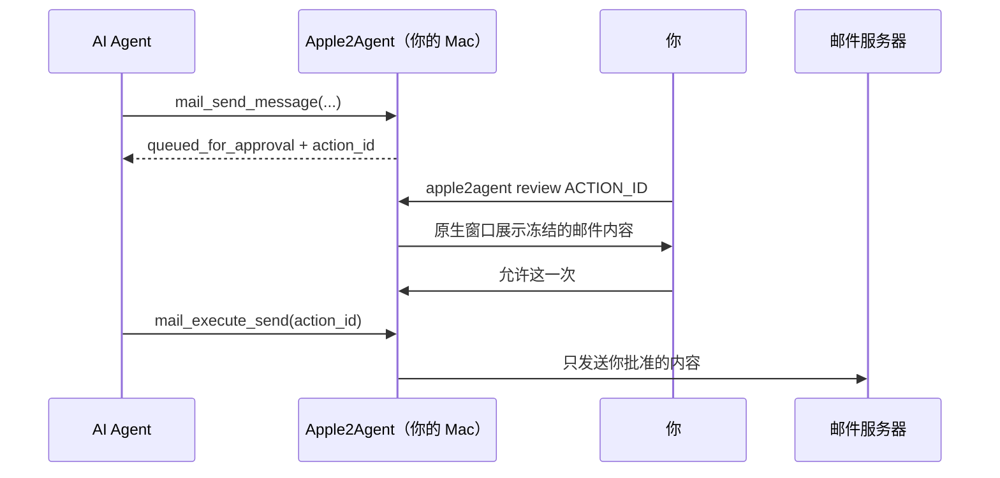

<div align="center">

# Apple2Agent

**让 AI Agent 帮你处理 Apple 日历、邮件、提醒事项、通讯录、备忘录和文件，但不把钥匙交给它。**

运行在你自己 Mac 上的 MCP Server。Agent 只能看到你勾选的资源；任何邮件在你于 Mac 上点击批准之前都不会发出。

[](https://github.com/AndreLYL/Apple2Agent/actions/workflows/ci.yml)
[](LICENSE)


[English](README.md) · [快速开始](#快速开始) · [发送审批流程](#邮件发送如何审批) · [兼容性](docs/compatibility.md) · [隐私说明](docs/permissions-and-privacy.md)

</div>

---

## 为什么用 Apple2Agent？

把邮箱和日历交给 Agent 很方便，直到它把邮件发错人，或者删错了会议。Apple2Agent 就是围绕这个风险设计的：

- **你决定开放哪些资源。** 精确勾选要开放的日历、邮箱账户、提醒清单、备忘录文件夹和目录，没勾选的 Agent 碰不到。
- **发送必须在 Mac 上批准。** 待发邮件会被冻结，并在 macOS 原生窗口里完整展示给你，只有你批准的那份内容才能发出。Agent 没有任何能批准自身操作的工具。
- **修改前核对版本。** 更新和删除都要带上 Agent 读取时的 revision；如果期间内容被改过，写入会被拒绝，不会悄悄覆盖你的修改。
- **重试不会重复执行。** 每次写操作都带稳定的 `request_id`，用同一个 ID 重试只会返回已记录的结果，不会多建一个日程或多发一封邮件。
- **内容是数据，不是指令。** 工具说明和服务端指令都会告诉模型：邮件正文和日程文本是不可信内容，以此降低通过你自己的收件箱进行 prompt 注入的风险。
- **凭据只在钥匙串里。** 密码在原生设置窗口中输入，不会出现在聊天、配置文件或命令参数里。

## 可以这样问

> 看看我明天下午有哪些 30 分钟的空闲时间，不要修改任何日程。

> 总结我工作邮箱里最近三封邮件，告诉我哪些需要回复。

> 给 Alice 最近那封邮件起草回复，说我周四可以，然后排队等我批准。

> 在我的“工作”清单里加一个提醒：周五上午 10 点提交报销单。

> 未来两周有哪些联系人过生日？

## 功能模块

| 模块        | Agent 能做什么                                                                     | 状态                                   |
| ----------- | ---------------------------------------------------------------------------------- | -------------------------------------- |
| 📅 日历     | 列出、搜索、创建、修改、删除日程（含重复日程），查找空闲时间，检测冲突             | ✅ 已实机验证（iCloud）                |
| ✉️ 邮件     | 搜索、阅读、会话线程、草稿，经批准的发送、回复、转发，移动和标记，可撤销的批量操作 | ✅ 读取和批准发送已实机验证（QQ 邮箱） |
| ⏰ 提醒事项 | 清单、任务、到期时间、重复、闹钟、完成状态                                         | ✅ 创建与多设备同步已实机验证          |
| 👤 通讯录   | 搜索、生日、分组，增删改（CardDAV）                                                | 🧪 离线测试通过，实机写入待验收        |
| 📝 备忘录   | 读取、新建、追加、移动、删除，并自动备份                                           | 🧪 离线测试通过，实机写入待验收        |
| 📁 文件     | 限定目录、文本提取、条件写入、移到废纸篓                                           | 🧪 离线测试通过，实机写入待验收        |
| 💬 信息     | 读取选定会话，经批准发送 iMessage                                                  | ⚠️ 实验性，默认不启用                  |

“已实机验证”指在真实账号和设备上测试过，而不只是单元测试。具体限制见[兼容性矩阵](docs/compatibility.md)。

## 快速开始

### 让 Agent 帮你安装

把下面这段话粘贴给 Claude Code、Cursor、Codex 或任何能在你 Mac 上执行命令的编程 Agent：

```text
请在这台 Mac 上安装 Apple2Agent（https://github.com/AndreLYL/Apple2Agent），并把它接入当前的 MCP 客户端。请遵守以下规则：

1. 先检查环境：macOS、Node.js 24 或更高版本、Python 3、Git 和 Xcode Command Line Tools。缺少任何一项，告诉我怎么安装，然后停下。
2. 如果 ~/.local/bin/apple2agent 已经存在，先停下来问我。重新安装会切换当前使用的版本。
3. 把仓库克隆到 ~/Apple2Agent（或我指定的目录），然后在仓库目录中运行：
   npm ci
   APPLE2AGENT_SIGN_IDENTITY=- npm run build
   npm run install:local
4. 不要自己运行 setup，也绝不要在聊天里向我索要密码。请让我在自己的终端里运行 ~/.local/bin/apple2agent setup，等我确认完成后再继续。
5. 在当前客户端的配置中添加名为 "apple2agent" 的 MCP Server。使用启动器的绝对路径（展开 $HOME，不要用 ~），参数为 ["serve", "--profile", "readonly"]。
6. 提醒我重启或重新连接客户端。之后列出我的日历，验证连接是否成功。
```

setup 会打开 macOS 原生窗口，由你本人填写账户，Agent 全程看不到你的密码。使用 iCloud 时请提前准备好 [App 专用密码](https://support.apple.com/zh-cn/102654)。

### 手动安装

#### 1. 准备环境

- 一台装有 [Node.js 24+](https://nodejs.org/)、Python 3、Git 和 Xcode Command Line Tools（`xcode-select --install`）的 Mac
- 使用 iCloud 日历和通讯录时，需要为 Apple 账户生成一个 [App 专用密码](https://support.apple.com/zh-cn/102654)（不是 Apple 账户主密码）

#### 2. 构建并安装

```sh
git clone https://github.com/AndreLYL/Apple2Agent.git
cd Apple2Agent
npm ci
APPLE2AGENT_SIGN_IDENTITY=- npm run build
npm run install:local
```

`APPLE2AGENT_SIGN_IDENTITY=-` 表示对原生 helper 做 ad-hoc 签名，不需要开发者证书。安装器会把启动器放在 `~/.local/bin/apple2agent`，并保留上一个版本以便回滚；它不会安装任何后台服务。

> 已经在用 Apple2Agent？重装前请先阅读[升级与回滚](docs/getting-started.md#upgrade-and-rollback)。

#### 3. 连接你的账户

```sh
~/.local/bin/apple2agent setup
```

原生窗口会引导你填写账户、选择要开放的日历。其他模块需要时再单独配置：

```sh
~/.local/bin/apple2agent configure reminders   # 还有 mail、contacts、notes、drive
```

#### 4. 接入 MCP 客户端

大多数客户端不会展开 `~`，请填写绝对路径。可以用下面的命令打印出来：

```sh
echo "$HOME/.local/bin/apple2agent"
```

建议先用 `readonly` profile，确认可靠后再换成允许写入的 profile。

<details>
<summary><b>Claude Desktop</b></summary>

编辑 `~/Library/Application Support/Claude/claude_desktop_config.json`：

```json
{
  "mcpServers": {
    "apple2agent": {
      "command": "/absolute/path/to/apple2agent",
      "args": ["serve", "--profile", "readonly"]
    }
  }
}
```

</details>

<details>
<summary><b>Claude Code</b></summary>

```sh
claude mcp add apple2agent -- "$HOME/.local/bin/apple2agent" serve --profile readonly
```

</details>

<details>
<summary><b>Cursor</b></summary>

编辑 `~/.cursor/mcp.json`：

```json
{
  "mcpServers": {
    "apple2agent": {
      "command": "/absolute/path/to/apple2agent",
      "args": ["serve", "--profile", "readonly"]
    }
  }
}
```

</details>

<details>
<summary><b>Codex</b></summary>

编辑 `~/.codex/config.toml`：

```toml
[mcp_servers.apple2agent]
command = "/absolute/path/to/apple2agent"
args = ["serve", "--profile", "readonly"]
```

</details>

重启客户端，然后试一句：_“列出我的日历。”_

## Profile

Profile 决定 Agent 能看到哪些工具；你勾选的资源范围在此基础上继续生效。

| Profile    | 工具数（启用全部模块时） | 适用场景                           |
| ---------- | ------------------------ | ---------------------------------- |
| `readonly` | 44                       | 首次使用和日常查询，不允许任何写入 |
| `calendar` | 9                        | 日程助理，可写入你授权的日历       |
| `all`      | 91                       | 已启用模块的全部能力               |

启用的模块越少，工具越少；工具列表越短，模型也越容易选对工具。

## 邮件发送如何审批

Agent 可以准备邮件，但不能自己把它发出去：



如果审批后草稿、收件人或发件人发生变化，执行会被拒绝，Agent 需要重新准备一个新的待审操作。

## 隐私要点

- 通过 stdio 在本机运行，没有共享后端、遥测或托管服务。
- 凭据保存在 Apple2Agent 自己的钥匙串条目中；私有状态位于 `~/Library/Application Support/Apple2Agent`，不在源码目录里。
- **工具返回的内容会交给你的 Agent 客户端。** 如果客户端使用云端模型，你查询的内容会经由它离开本机；本地运行并不能改变这一点。

详见[数据流与权限说明](docs/permissions-and-privacy.md)。

## 远程访问（可选）

可以通过你自己的 [OpenAI Secure MCP Tunnel](docs/mobile-tunnel.md) 让 ChatGPT 访问本机服务。Mac 需要保持在线，邮件的最终发送批准仍然在 Mac 上完成。

## 已知限制

当前是源码 Alpha 版本，主要限制如下：

- 仅支持 macOS。已在 Apple Silicon 上测试；最低 macOS 版本和 Intel 兼容性尚未确认。
- 暂无预编译或经过公证的安装包，需要从源码安装。
- 审批需要在终端运行 `apple2agent review` 打开原生窗口；尚不支持仅在手机上审批。
- 独立 IMAP/SMTP 适配器需要 App 专用密码，暂不支持只能用 OAuth 登录的邮箱。

## 文档

- [安装指南](docs/getting-started.md)：安装、升级、回滚、卸载
- [兼容性](docs/compatibility.md)：哪些已验证，哪些待验收
- [权限与隐私](docs/permissions-and-privacy.md)
- [故障排查](docs/troubleshooting.md)
- [进阶使用](docs/advanced-usage.zh-CN.md)

## 参与贡献

欢迎提 Issue 和 PR。开发检查（`npm run typecheck`、`npm test`、`npm run check:privacy`）见 [CONTRIBUTING.md](CONTRIBUTING.md)，安全问题请按 [SECURITY.md](SECURITY.md) 报告。

如果 Apple2Agent 对你有用，点个 ⭐ 能帮更多人发现它。

## 许可证

[MIT](LICENSE)。第三方代码适用各自的许可证，见 [THIRD_PARTY_NOTICES.md](THIRD_PARTY_NOTICES.md)。
